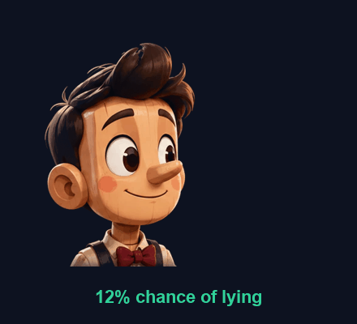
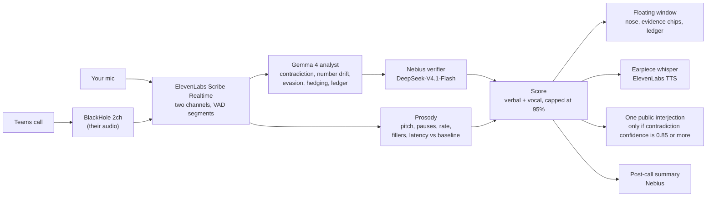

<p align="center">
  

<p align="center"></p>

</p>

# Pinoqio

**The negotiation copilot whose nose grows when theirs should.**

**[Live demo → pinoqio.pro7ocol.com](https://pinoqio.pro7ocol.com)** · MIT · built at Hacktoberfest Hack Day Barcelona, 24 Oct 2026

## 30-second pitch

Negotiations are won by whoever notices that the price quietly moved from 40k to 48k, or that a direct question never got an answer. Humans miss this because they are busy talking.

Pinoqio is a silent teammate on your Teams call. It transcribes both sides, keeps a ledger of every number and promise, and checks each new thing the other side says against what they said before. When something does not add up it shows evidence (the two quotes, the changed number, the dodged question) next to a live **deception-cue score**, and a Pinocchio nose that grows with it. It whispers a short "ask this now" into your earpiece. Once per call, when a contradiction is near-certain, it politely says it out loud in the meeting. After the call you get a summary: commitments, open questions, red flags with quotes, and a draft follow-up email.

It never claims to detect lies. It shows cues and evidence, and it is honest about how weak those cues are (see [Honest limits](#honest-limits)).

## Try it

- **Recorded demo** (no keys, no sign-in): open [pinoqio.pro7ocol.com](https://pinoqio.pro7ocol.com). It replays a scripted supplier call (voiced with ElevenLabs TTS, see `copilot/demo/script.md`) that was run once through the real pipeline and recorded.
- **Try live** (passcode-gated, one session at a time, 5 minute cap): same page, your mic plus a shared browser tab's audio. Ask us for the passcode; the button only appears when the server has one set. Use Chrome and tick "Share tab audio".

## How it works



1. **Ears** (`copilot/pinoqio/stt.py`, `ears.py`, `prosody.py`). Your mic and the call audio (captured from the BlackHole virtual device) go to ElevenLabs Scribe Realtime (`scribe_v2_realtime`), one websocket per speaker. Each committed segment gets prosody features (pitch, speech rate, pause ratio, fillers, response latency), expressed as z-scores against that speaker's own running baseline.
2. **Brain** (`analyst.py`, `verifier.py`, `brain.py`). Gemma 4 (`gemma-4-26b-a4b-it` through the Gemini API) reads each counterparty utterance with the transcript and the promise ledger, and returns structured findings. Any contradiction or number drift it reports is re-checked by a second model, DeepSeek-V4.1-Flash on Nebius. A rejected contradiction is dropped, a confirmed number drift is upgraded to a contradiction, and if the verifier is down the confidence is capped below the interjection bar. Nebius also takes over as analyst if Gemma errors or takes longer than 8 s.
3. **Score** (`score.py`). A transparent logistic model: verbal cues carry most of the weight, vocal cues are small and capped, the output never exceeds 95%. Every contribution is shown as a chip with its quote.
4. **Face** (`window.py`, `server.py`, `ui/`). A native always-on-top window with the Pinocchio nose, evidence chips, the live ledger, and the post-call summary sheet.
5. **Voice** (`voice.py`). ElevenLabs TTS (`eleven_flash_v2_5`) to two named output devices: a private earpiece for whispers (at most one per 8 s, only above 60%) and the call for the single public interjection. The policy is a pure, unit-tested function.

## Honest limits

- **Deception cues are weak, and we say so in the code.** In meta-analyses, vocal pitch correlates with lying at roughly d ≈ 0.27 and response latency at d ≈ 0.18 (Sporer & Schwandt, 2006), and most nonverbal cues are unreliable (DePaulo et al., 2003). The best multimodal deception detection models reach about 65% on the DOLOS benchmark (ICCV 2023). So vocal cues get a small weight and a hard cap, the verdict is capped at 95%, and nothing is ever labelled "liar". The score is a prompt to ask a better question.
- **The strongest signal is not paralinguistic.** Contradictions with the other side's own earlier words, and numbers that changed, are checkable facts. That is where Pinoqio puts its weight, and why it uses a second model to verify them.
- **Contradiction is not the same as lying.** Offers legitimately change in a negotiation. The analyst prompt is tuned for precision over recall, but it can still be wrong, which is why the public interjection is a question ("Which one is it?"), not an accusation.
- **Voice modes.** `--voice public` says each contradiction out loud into the call (rotating sarcastic lines from `shared/pinoqio-art/lines.json`), `--voice whisper` cues an earpiece, `--voice private` stays silent and only shows the evidence.
- **Mac only, prototype audio routing.** Call audio is captured through BlackHole, with device names set by environment variables. The web "Try live" mode works in any browser that can share tab audio.
- **No benchmark.** We verified the two contradictions planted in our demo script (both caught at 0.95 confidence by the verifier) and 93 unit tests. We have not measured precision or recall on real negotiations.
- **Your audio goes to third parties** (ElevenLabs, Google, Nebius) for transcription and analysis. Tell the people on your call.

## Quick start (macOS)

Needs [uv](https://docs.astral.sh/uv/), Python 3.12+.

```bash
git clone https://github.com/bioztar/pinoqio && cd pinoqio
cp .env.example .env        # fill GEMINI_API_KEY, ELEVENLABS_API_KEY, NEBIUS_API_KEY
cd copilot && uv sync

uv run python -m pinoqio.app --source fake       # scripted call, no keys, no audio
uv run python -m pinoqio.app --source replay \
  --them-wav demo/replay/them.wav --me-wav demo/replay/me.wav   # scripted call, real Scribe + Gemma (needs keys)
uv run python -m pinoqio.web                      # the web demo on http://localhost:8000
uv run pytest                                     # 93 tests
```

Live on a real call:

1. `brew install --cask blackhole-2ch`
2. In Audio MIDI Setup, create a Multi-Output Device (your speakers or headphones plus BlackHole 2ch) and select it as the output in Teams.
3. Set `PINOQIO_THEM_DEVICE` (default `BlackHole 2ch`) and `PINOQIO_ME_DEVICE` (default `MacBook Air Microphone`) if yours differ.
4. `uv run python -m pinoqio.app --source live`

The server on pinoqio.pro7ocol.com is the same code in Docker: see `copilot/deploy/compose.yml`. Set `PINOQIO_LIVE_PASSCODE` to enable Try live.

## Prize tracks

- **Gemma 4.** Gemma 4 26B-A4B is the analyst that reads every utterance: contradiction, number drift, evasion, hedging, and the promise ledger, with structured JSON output at temperature 0.
- **ElevenLabs.** Scribe Realtime for two-channel streaming transcription, and Flash v2.5 TTS for the earpiece whisper and the public interjection.
- **Open source (MIT).** The whole repo is MIT licensed and public. Keys live only in a gitignored `.env`.
- We also use **Nebius** (DeepSeek-V4.1-Flash) as the independent verifier, fallback analyst and post-call summariser.

## Repository layout

| Path | What |
|---|---|
| `copilot/` | Pinoqio, the call copilot. See [`copilot/README.md`](copilot/README.md) and [`copilot/docs/architecture.md`](copilot/docs/architecture.md). |
| `judge/` | Our entry for Plata's "A Judge That Learns from an Expert" track. See [`judge/README.md`](judge/README.md). |
| `coord/` | Status board and decisions log shared by the two lanes. |
| [`copilot/docs/DEVPOST.md`](copilot/docs/DEVPOST.md) | Devpost submission text. |

## Judge lane (Plata track)

A separate project in the same repo, built by the other half of the team. It has its own key (`GEMINI_API_KEY_JUDGE`) so it does not share the copilot's Gemma quota. Everything about it is in [`judge/README.md`](judge/README.md).

## License

MIT, see [LICENSE](LICENSE). Gemma 4 (Google DeepMind, Apache-2.0) via the Gemini API.

Per the event rules, all project work started at the event (11:30 CET, 24 October 2026). The repository was created the night before and held only the license and placeholders.

## Honest numbers

On 56 scripted negotiation lines (8 scenarios): contradictions 100% precision / 88% recall, any-flag recall 88%, 25% false flags on honest lines. Text only, one run. Full report: [`copilot/eval/report.md`](copilot/eval/report.md).
