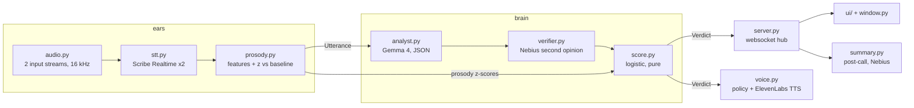

# Architecture

Everything flows through one frozen contract, `copilot/pinoqio/events.py`: `Utterance` (ears → brain), `Verdict` (brain → face and voice), plus `Chip`, `Contradiction`, `LedgerItem`.

## Modules

| Module | Role |
|---|---|
| `audio.py` | Two `sounddevice` input streams (`PINOQIO_THEM_DEVICE`, `PINOQIO_ME_DEVICE`) to 16 kHz mono int16 chunks. |
| `stt.py` | One ElevenLabs Scribe Realtime websocket per speaker; reconnects; yields voiced-span audio per committed segment. |
| `prosody.py` | Pitch, rate, pause ratio, fillers, latency, and running per-speaker baseline z-scores. |
| `ears.py` | Combines the above into an `Utterance` stream. Sources: `live`, `replay` (wav files), `stream` (browser audio). |
| `analyst.py`, `prompts/analyst.md` | One Gemma call per counterparty utterance: contradiction, number drift, evasion, hedging, ledger updates, next question. |
| `gemma.py`, `nebius.py` | Async JSON clients. Gemma 26B-A4B at temperature 0, 10 s timeout, one retry. Nebius via its OpenAI-compatible API. |
| `verifier.py`, `prompts/verifier.md` | Second model checks contradictions and number drifts. Unverified findings are capped at 0.8 confidence, below the 0.85 interjection bar. |
| `brain.py` | Stream glue: analyse (8 s Gemma budget, Nebius fallback), verify, update ledger, score, attach model badge. Never raises. |
| `score.py` | Pure function from `Analysis` + prosody to `Verdict`. Prior ≈ 12%, vocal logit capped at 0.8, probability capped at 95%. |
| `voice.py` | `decide()` policy (whisper above 60% with an 8 s gap; one public interjection at contradiction confidence ≥ 0.85) and ElevenLabs Flash v2.5 playback to named devices. |
| `summary.py`, `prompts/summary.md` | End-of-call summary on Nebius, with an offline fallback built from the ledger and flagged contradictions. |
| `server.py`, `ui/`, `window.py` | FastAPI websocket hub, the single-page UI, and the pywebview always-on-top window. |
| `app.py` | Desktop entry point: `--source fake\|live\|replay`. |
| `web.py`, `live.py`, `record.py` | Web demo (replays `demo/replay/events.jsonl`, no API calls), passcode-gated "Try live" over websocket (5 min cap, one session at a time), and event recording. |

## Failure behaviour

A failed model call must never kill the live pipeline. Gemma error or timeout → Nebius analyses. Both fail → neutral analysis, vocal-only verdict. Verifier fails → keep Gemma's finding, cap confidence. Voice playback errors are logged and skipped. Summary failure → offline summary.

## Known gap

`app.py` expects a module-level `pinoqio.voice.on_verdict`. `voice.py` currently exposes `Voice.on_verdict` instead, so the desktop app does not speak automatically yet. `scripts/smoke_voice.py` exercises the voice path directly.

## Deployment

`copilot/Dockerfile` + `copilot/deploy/compose.yml` run `pinoqio.web` behind Traefik at https://pinoqio.pro7ocol.com. Keys and `PINOQIO_LIVE_PASSCODE` live only in a gitignored `.env` on the host.
